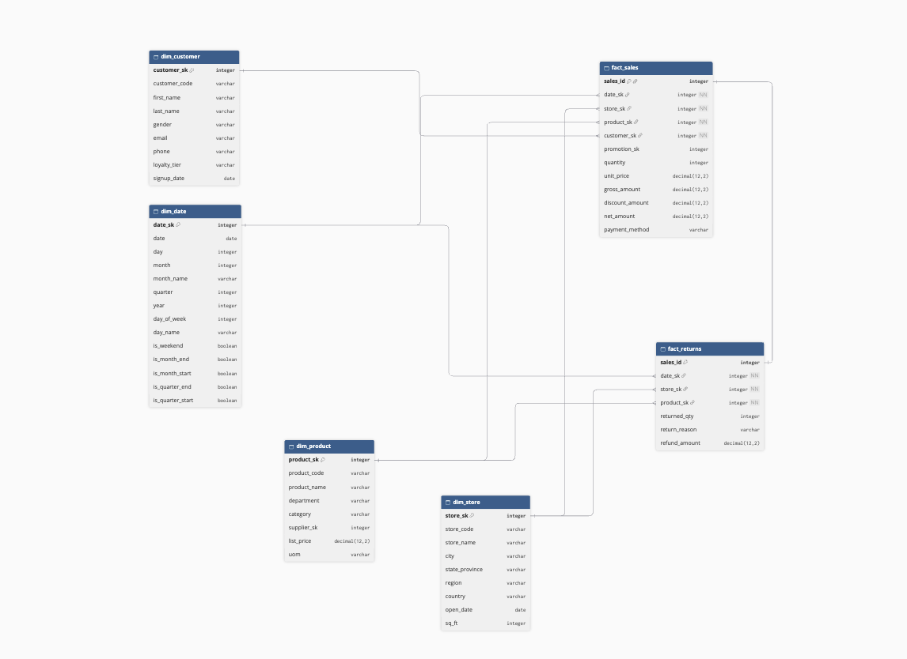
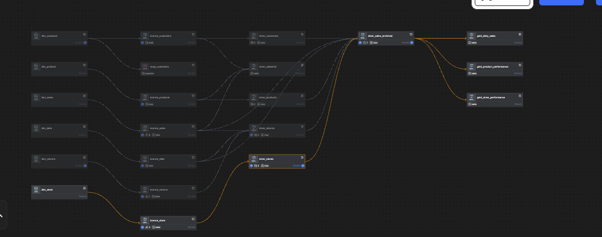

# Retail Data Analytics Pipeline | dbt & PostgreSQL

## Overview

This project implements an end-to-end retail analytics pipeline using **dbt Core, PostgreSQL, Python, and SQL**.

The goal is to transform raw retail data into clean, reliable datasets and business-ready analytics using the **Medallion Architecture (Bronze → Silver → Gold)**.

The pipeline includes data transformations, automated data-quality tests, historical tracking with dbt snapshots, and separate development and production environments.

## Database Design



## dbt Project Lineage




## Tech Stack

- **PostgreSQL** — Data storage and SQL transformations
- **dbt Core** — Data modeling, testing, and documentation
- **Python & Pandas** — CSV data ingestion
- **uv** — Python dependency management
- **Git & GitHub** — Version control

## Dataset

The project uses six retail datasets:

| Table | Description |
|---|---|
| `dim_customer` | Customer information and loyalty membership |
| `dim_product` | Product details, categories, and prices |
| `dim_store` | Store locations and attributes |
| `dim_date` | Calendar dimensions |
| `fact_sales` | Sales transactions, quantities, and revenue |
| `fact_returns` | Product returns and refunds |

The data follows a star-schema structure, connecting sales and returns to their related dimensions.
the dataset can be found: https://github.com/anshlambagit/AnshLambaYoutube/tree/main/DBT_Masterclass


## Data Architecture

### 1. Bronze Layer — Raw Data

The bronze layer reads source tables from PostgreSQL and prepares them for downstream transformations.

**Responsibilities:**
- Reference source tables using dbt `source()`
- Apply basic type casting and initial standardization
- Preserve the original transactional structure

### 2. Silver Layer — Data Transformation

The silver layer cleans, joins, and enriches datasets.

**Key transformations:**
- Standardize customer and product attributes
- Handle missing values and inconsistent text
- Classify customers, products, and stores
- Join sales with customer, product, store, and date dimensions
- Calculate retained revenue, discounts, and return rates
- Identify potentially invalid refund amounts and quantities

The main model, `silver_sales_enriched`, provides one enriched record per sales transaction.
This is the final step in the silver model. From here business critcal data can be extracted.

### 3. Gold Layer — Business Analytics

The gold layer contains aggregated tables designed for reporting and business decisions.
You can plug this into power bi or tableu

| Model | Business Question |
|---|---|
| `gold_daily_sales` | How much revenue is generated each day? |
| `gold_store_performance` | Which stores generate the most revenue? |
| `gold_product_performance` | Which products perform best, and which have high return rates? |

**Key metrics:** Revenue, refunds, average sale value, sales volume, store rankings, and product return rates.

## Data Quality & Testing

dbt tests are used to validate data throughout the pipeline.

Implemented checks include:

- `unique` — Detect duplicate identifiers
- `not_null` — Validate required fields
- `accepted_values` — Validate categorical values
- `relationships` — Check referential integrity
- Custom SQL tests — Validate financial amounts and reconcile sales totals between layers

Tests help detect data-quality issues before they affect downstream analytics.

## Historical Tracking — dbt Snapshots

The project implements **Slowly Changing Dimension Type 2 (SCD2)** using dbt snapshots.

Two strategies are demonstrated:

- **Check strategy:** Tracks customer attribute changes such as names and emails.
- **Timestamp strategy:** Detects changes to return records using `updated_at`.

Snapshots preserve previous versions of records using `dbt_valid_from` and `dbt_valid_to`.

## Development & Production

The project supports separate PostgreSQL environments through dbt targets.

| Environment | Database | Raw Data Schema |
|---|---|---|
| Development (`dev`) | `source` | `source` |
| Production (`prod`) | `Business_production` | `source` |

The same dbt project can be executed against either environment without duplicating model code.

## Getting Started

### 1. Install dependencies

```bash
uv sync
```

### 2. Configure PostgreSQL

Create `~/.dbt/profiles.yml` with the appropriate development and production connection details.

Ensure the six raw tables have been imported into their corresponding PostgreSQL source schemas.

### 3. Verify the connection

From the directory containing `dbt_project.yml`:

```bash
dbt debug --target dev
```

### 4. Build the development pipeline

```bash
dbt build --target dev
```

### 5. Run individual layers

```bash
dbt run --select path:models/bronze --target dev
dbt run --select path:models/silver --target dev
dbt run --select path:models/gold --target dev
```

### 6. Execute tests and snapshots

```bash
dbt test --target dev
dbt snapshot --target dev
```

### 7. Deploy to production

After configuring and validating production access:

```bash
dbt build --target prod
```
You need to acess the hidden file profile.yml so that you edit your connections


## Key Concepts Demonstrated

- ELT pipelines and Medallion Architecture
- SQL transformations using CTEs, joins, aggregations, and window functions
- Dimensional data modeling
- dbt models, sources, seeds, macros, and tests
- SCD Type 2 snapshots
- Data-quality validation and reconciliation
- Development and production environment separation
- Business KPI modeling

## Project Outcome

The project demonstrates how raw transactional data can be transformed into structured, tested, and business-ready datasets.

It provides a foundation for analyzing retail sales, comparing store performance, monitoring product returns, and supporting data-driven business decisions.

Hopefully if you reading this HIRE ME!!!!!!!
