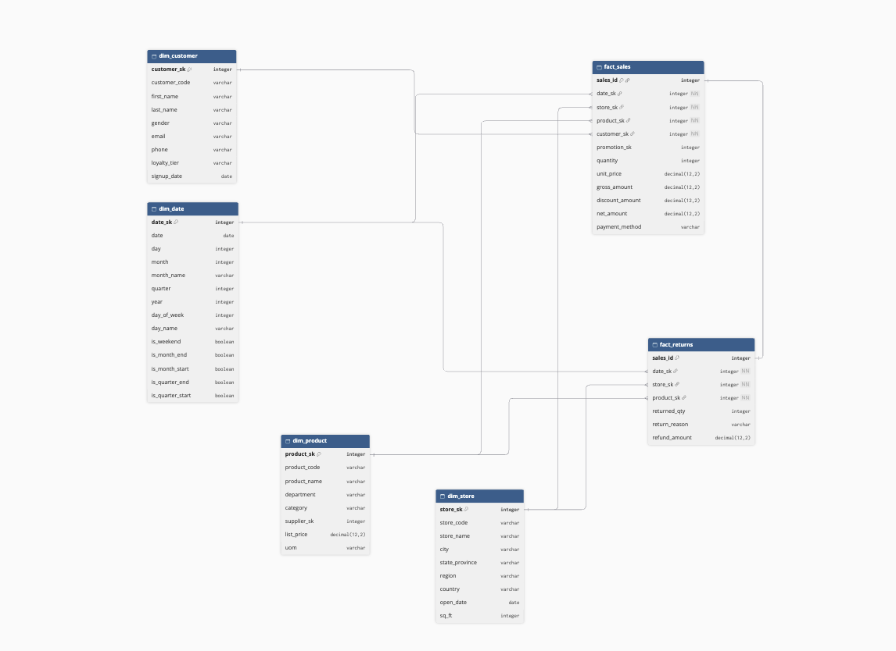
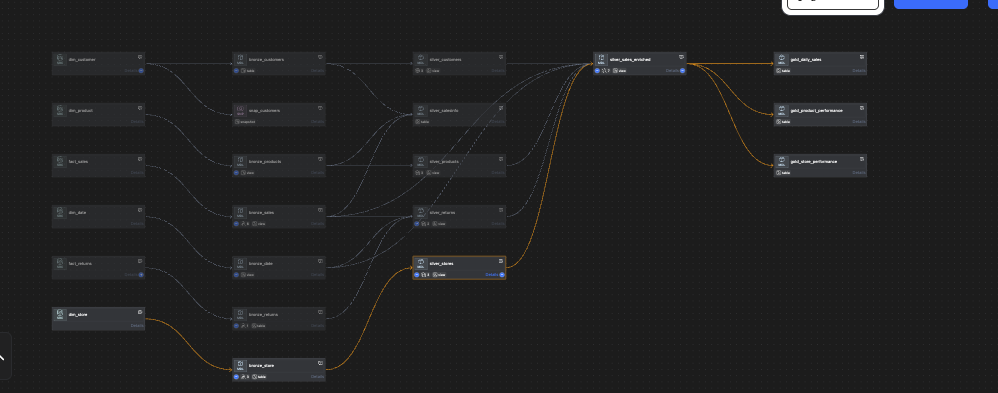

# Retail Data Analytics Pipeline | dbt & PostgreSQL

## Overview

An end-to-end retail analytics pipeline built with **dbt Core, PostgreSQL, Python and SQL**.

Raw retail data is transformed into clean, tested, business-ready datasets using the **Medallion Architecture (Bronze → Silver → Gold)**. The pipeline includes automated data-quality tests, cross-layer reconciliation checks, SCD Type 2 history with dbt snapshots, and separate development and production environments.

## Database Design

Source schema (defined in [`docs/database_schema_design.dbml`](docs/database_schema_design.dbml)):



## dbt Lineage



## Tech Stack

- **PostgreSQL**: storage and SQL transformations
- **dbt Core**: modeling, testing, snapshots and documentation
- **Python & pandas**: CSV ingestion ([`scripts/load_raw_data.py`](scripts/load_raw_data.py))
- **uv**: Python dependency management

## Dataset

Six retail tables in a star schema: sales and returns facts connected to customer, product, store and date dimensions.

| Table | Description |
|---|---|
| `dim_customer` | Customer information and loyalty membership |
| `dim_product` | Product details, categories and prices |
| `dim_store` | Store locations and attributes |
| `dim_date` | Calendar attributes |
| `fact_sales` | Sales transactions, quantities and revenue |
| `fact_returns` | Product returns and refunds (one return per sale) |

Dataset source: [AnshLambaYoutube / DBT_Masterclass](https://github.com/anshlambagit/AnshLambaYoutube/tree/main/DBT_Masterclass)

## Data Architecture

### 1. Bronze: raw data

One model per source table, selected 1:1 via `source()`. Bronze isolates every downstream model from the physical location of the raw data, which differs between dev and prod. Source-level tests (uniqueness, non-negative amounts, `gross = quantity × unit_price`, `net = gross − discount`) run here so bad data is caught before any transformation.

### 2. Silver: cleaned and enriched

- Standardizes text (trimming, casing, empty strings to `NULL`) and casts types
- Classifies customers (loyalty), products (price bands) and stores (size bands)
- Categorizes return reasons using the `return_reasons` seed
- Flags data-quality problems on returns: orphan returns, refunds above the original sale, returned quantity above sold quantity, mismatched product/store references
- `silver_sales_enriched` joins sales to every dimension and to aggregated returns, producing **one row per sale** with retained revenue, discount rate and return rate

### 3. Gold: business analytics

Aggregated tables ready for Power BI or Tableau.

| Model | Grain | Business question |
|---|---|---|
| `gold_daily_sales` | one row per day | How much revenue is generated each day? |
| `gold_store_performance` | one row per store | Which stores generate the most revenue? |
| `gold_product_performance` | one row per product | Which products perform best, and which have high return rates? |

## Design Decisions

- **Returns are aggregated before joining to sales.** Joining raw returns to sales would duplicate sales rows if a sale ever had more than one return. `silver_sales_enriched` aggregates returns to `sales_id` first, and the reconciliation tests prove that row counts and revenue totals match bronze exactly.
- **Data-quality issues are flagged, not filtered.** Suspicious returns stay in the data with boolean flags, so analysts can see and quantify them instead of losing them silently. Expected issues (orphan returns, unknown return reasons) are `warn` tests, while structural guarantees (keys, grain, reconciliation) are `error` tests.
- **Business rules live in seeds.** Return-reason categories are a CSV seed, so the mapping can be changed without editing SQL.
- **Every gold model declares and tests its grain** with `unique` and `not_null` tests on its key.
- **Environment-aware sources.** The raw schema is chosen from the dbt target, so the same code runs against dev and prod.

## Data Quality & Testing

| Type | Examples |
|---|---|
| Generic | `unique`, `not_null`, `accepted_values`, `relationships` |
| Custom generic | `non_negative` ([`tests/generic/non_negative.sql`](dbt_projects/tests/generic/non_negative.sql)) |
| Singular | Sales arithmetic consistency; bronze → silver reconciliation of row counts, revenue, refunds and returned units |

## Historical Tracking: dbt Snapshots

SCD Type 2 history is kept with two snapshot strategies:

- **Check strategy** (`snap_customers`): `dim_customer` has no last-modified column, so a new version is recorded when name or email changes.
- **Timestamp strategy** (`snap_returns`): uses `fact_returns.updated_at`.

Each version is bounded by `dbt_valid_from` / `dbt_valid_to`. See [`analyses/`](dbt_projects/analyses/) for example history queries.

## Development & Production

| Target | Database | Raw data schema | dbt output schemas |
|---|---|---|---|
| `dev` | `source` | `public` | `bronze`, `silver`, `gold` |
| `prod` | `Business_production` | `source` | `bronze`, `silver`, `gold` |

## Getting Started

```bash
# 1. Install dependencies
uv sync

# 2. Load the raw CSVs (credentials come from environment variables)
export PGPASSWORD=...  PGDATABASE=source
uv run python scripts/load_raw_data.py --data-dir path/to/csvs --schema public

# 3. Configure dbt: copy the example profile and set DBT_PG_PASSWORD
cp dbt_projects/profiles.example.yml ~/.dbt/profiles.yml
export DBT_PG_PASSWORD=...

# 4. Build everything (seeds, snapshots, models and tests in dependency order)
cd dbt_projects
uv run dbt debug
uv run dbt build

# Build a single layer
uv run dbt build --select models/silver

# Deploy to production
uv run dbt build --target prod
```

## Key Concepts Demonstrated

- ELT and Medallion Architecture
- Dimensional modeling and explicit model grain
- SQL with CTEs, joins, aggregations and window functions
- dbt sources, seeds, snapshots, custom generic tests and singular tests
- Cross-layer reconciliation testing
- SCD Type 2 with check and timestamp strategies
- Environment separation with dbt targets
